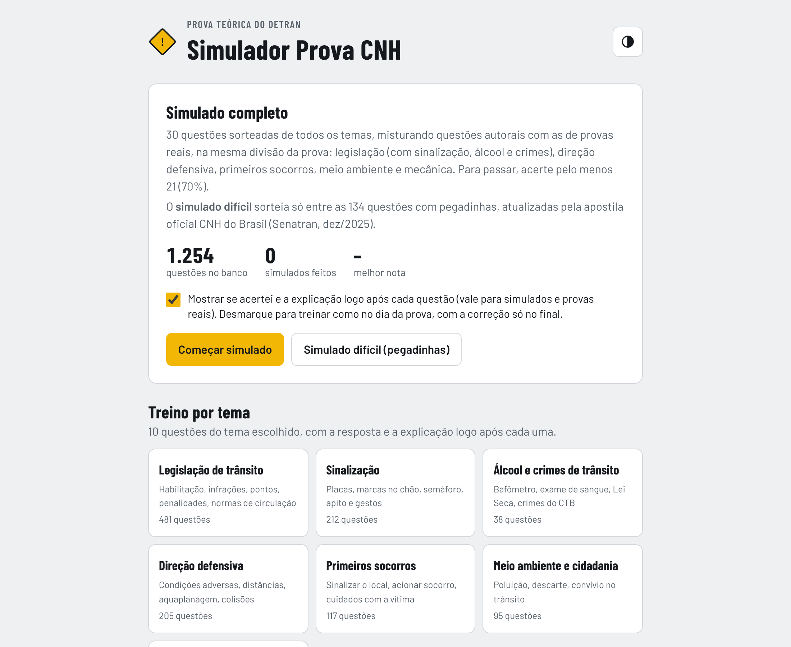
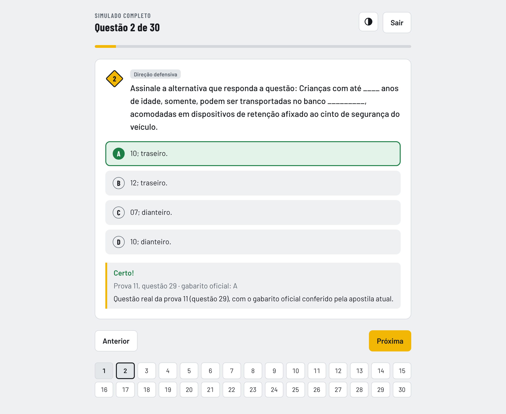
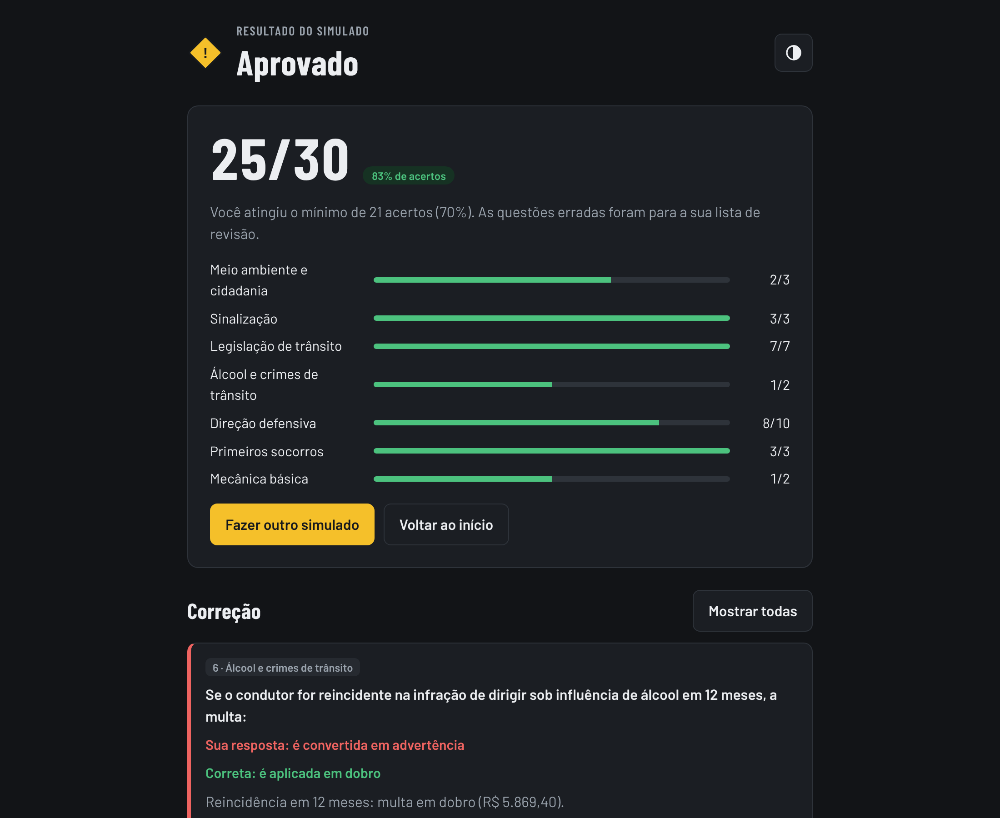
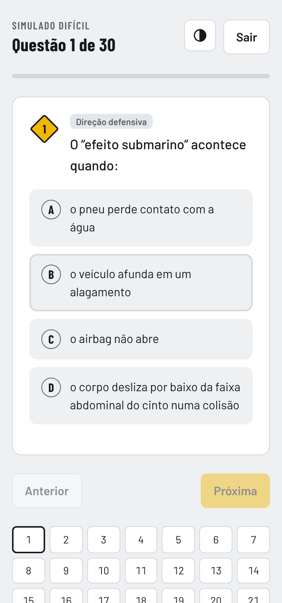

# 🚦 Simulador Prova CNH

[](https://github.com/PedroLung/simulador-cnh/actions/workflows/ci.yml)


Simulador da **prova teórica do Detran** com **1.254 questões únicas**, simulados no mesmo formato da prova oficial (30 questões, 70% para passar), treino por tema, revisão automática dos erros e **38 provas reais** com o gabarito conferido pela legislação atual. Funciona no celular, no modo escuro e **offline** (PWA instalável).

**[▶ Ver online](https://pedrolung.github.io/simulador-cnh/)**



## Funcionalidades

- **Simulado completo**: 30 questões sorteadas na mesma divisão por tema da prova do Detran. Aprovação com 21 acertos (70%).
- **Simulado difícil**: sorteia entre 134 questões com pegadinhas, escritas com base na apostila oficial CNH do Brasil (Senatran, dez/2025).
- **Treino por tema**: 10 questões de um dos 7 temas, com resposta e explicação logo após cada uma.
- **Provas reais**: 38 provas antigas na ordem original. Quando a lei mudou, o app mostra o **gabarito antigo e a resposta de hoje**, com a explicação.
- **Revisão de erros**: toda questão errada entra numa lista de revisão e sai dela quando você acerta.
- **Correção imediata ou no final**, como no dia da prova.
- **Resultado detalhado**: nota, aprovação, desempenho por tema e correção questão a questão.
- **Histórico** salvo no navegador, sem cadastro e sem backend.
- **Imagens das placas**: quando a questão cita o código da placa (R-1, A-2a...), a imagem aparece junto, como na prova do Detran.
- **Tema claro ou escuro** com um toque (começa seguindo o sistema), layout responsivo, **PWA offline**.
- **Atalhos de teclado** (`A`–`D`/`1`–`4` respondem, `→`/`Enter` avança, `←` volta) e cuidado com acessibilidade (HTML semântico, `aria-live`, foco visível, `prefers-reduced-motion`).

| Questão com correção imediata           | Resultado (modo escuro)                            | Celular                                |
| --------------------------------------- | -------------------------------------------------- | -------------------------------------- |
|  |  |  |

## Stack

| Camada             | Tecnologia                                                                              |
| ------------------ | --------------------------------------------------------------------------------------- |
| UI                 | **React 19** com componentes funcionais e hooks                                         |
| Linguagem          | **TypeScript** em modo `strict`                                                         |
| Build e dev server | **Vite 8** (Rolldown)                                                                   |
| Estilo             | **Tailwind CSS 4** com design tokens em variáveis CSS (tema claro/escuro)               |
| Offline            | **vite-plugin-pwa** (Workbox): precache do app e cache das fontes                       |
| Testes             | **Vitest** + **Testing Library** + jsdom (1.398 testes)                                 |
| Qualidade          | **Oxlint** (com regras de React, a11y e Vitest) e **Prettier**                          |
| CI/CD              | **GitHub Actions**: lint → formatação → tipos → testes → build → deploy no GitHub Pages |

## Arquitetura

```
src/
├── assets/placas/           # SVGs das placas citadas nos enunciados
├── data/                    # banco de questões em JSON (dados separados do código)
│   ├── temas.json
│   ├── questoes-autorais.json
│   └── questoes-provas.json
├── lib/                     # regras de negócio puras, 100% testadas
│   ├── tipos.ts             # tipos do domínio (Questao, Sessao, Modo...)
│   ├── banco.ts             # normaliza o JSON e monta o banco
│   ├── sorteio.ts           # sorteio dos simulados (Fisher–Yates com RNG injetável)
│   ├── correcao.ts          # nota, aprovação, lista de erros, letras do gabarito
│   └── placas.ts            # acha a placa citada no enunciado
├── hooks/                   # useLocalStorage, useTheme, useProgresso
├── components/              # Home, Quiz, Resultado, Gabarito, ImagemPlaca, ThemeToggle, ui
├── App.tsx                  # máquina de estados das telas: início → quiz → resultado
└── main.tsx
```

Decisões que valem destacar:

- **Lógica separada da interface.** Tudo o que decide nota, sorteio e gabarito está em `src/lib` como funções puras. Os componentes só renderizam e disparam ações, o que deixa a regra de negócio fácil de testar e de reaproveitar.
- **Sorteio testável.** `embaralhar` e `criarSessao` recebem o gerador de números aleatórios por parâmetro. Nos testes uso um gerador com semente (mulberry32), então os resultados são reproduzíveis.
- **Gabarito que acompanha a mudança da lei.** No banco a alternativa correta fica sempre na posição 0 e a tela embaralha as opções. Para as provas reais, guardo um mapa de posições que reconstrói as letras originais, e assim mostro o gabarito antigo e o atual nas letras certas.
- **Banco validado nos testes.** Um teste por questão confere tema, 4 alternativas distintas, explicação e ids únicos. Esses testes rodam no CI antes de todo deploy e já encontraram alternativas duplicadas vindas do PDF original.
- **Bundle dividido.** O banco de questões (~470 KB) vai num chunk próprio, separado do código do app e do React. Como as questões mudam pouco, o navegador reaproveita o cache quando só o código é atualizado.
- **Tema sem flash e sem `dark:` espalhado.** As cores são variáveis CSS mapeadas para tokens do Tailwind (`bg-surface`, `text-muted`...). Antes do JavaScript carregar, o CSS segue `prefers-color-scheme`; o botão alterna entre claro e escuro trocando só um atributo no `<html>`.

A documentação técnica completa está em [`docs/`](docs/README.md).

## Como rodar

Requer Node.js 20.19 ou superior (a versão usada está em `.nvmrc`).

```bash
git clone https://github.com/PedroLung/simulador-cnh.git
cd simulador-cnh
npm install
npm run dev        # http://localhost:5173
```

| Script            | O que faz                                                        |
| ----------------- | ---------------------------------------------------------------- |
| `npm run dev`     | servidor de desenvolvimento com hot reload                       |
| `npm run build`   | checa os tipos e gera o build em `dist/`                         |
| `npm run preview` | serve o build localmente (para testar o PWA/offline)             |
| `npm test`        | roda os testes uma vez (`npm run test:watch` para modo contínuo) |
| `npm run lint`    | Oxlint                                                           |
| `npm run format`  | formata com Prettier                                             |
| `npm run check`   | lint + formatação + tipos + testes (o mesmo que o CI)            |

## Deploy

O build usa caminhos relativos (`base: './'`), então o mesmo `dist/` funciona em qualquer hospedagem estática.

**GitHub Pages (já configurado)**

1. Crie o repositório e dê push na branch `main`.
2. Em **Settings → Pages → Build and deployment**, escolha **Source: GitHub Actions**.
3. O workflow [`ci.yml`](.github/workflows/ci.yml) roda lint, testes e build, e publica em `https://pedrolung.github.io/simulador-cnh/`.

**Vercel**: importe o repositório em _Add New → Project_. O `vercel.json` já define o framework Vite e a pasta `dist`.

**Netlify**: _Add new site → Import an existing project_. O `netlify.toml` já define `npm run build` e a pasta `dist`.

## Como adicionar questões

Edite `src/data/questoes-autorais.json`. A primeira alternativa é sempre a correta (a tela embaralha):

```json
{
  "tema": "leg",
  "enunciado": "Enunciado da questão:",
  "alternativas": ["correta", "errada 1", "errada 2", "errada 3"],
  "explicacao": "Explicação mostrada após a resposta.",
  "dificil": false
}
```

Temas: `leg`, `sin`, `alc`, `dd`, `ps`, `ma`, `mec`. Rode `npm test` para validar o banco antes do commit. Detalhes em [docs/banco-de-questoes.md](docs/banco-de-questoes.md).

Se o enunciado citar o código de uma placa, a imagem aparece sozinha quando o SVG existe em `src/assets/placas/`. Para baixar as que faltam: `bash scripts/baixar-placas.sh` ([docs/placas.md](docs/placas.md)).

> Os ids das questões autorais vêm da posição no arquivo (`a0`, `a1`...), e a lista de erros de cada usuário guarda esses ids. Adicione questões novas **no fim** do arquivo para não embaralhar a revisão de quem já usa o app.

## Aviso sobre o conteúdo

- Projeto pessoal de estudo e portfólio. **Não é um serviço oficial** do Detran, da Senatran ou de qualquer órgão de trânsito.
- As questões autorais foram escritas com base no Código de Trânsito Brasileiro e na apostila oficial CNH do Brasil (Senatran, dez/2025).
- As questões das provas reais (`questoes-provas.json`) foram transcritas de provas e simulados públicos usados para estudo, e os direitos pertencem aos respectivos autores. Estão aqui só para fins educacionais e sem fins lucrativos. Se você é titular de algum desses conteúdos e quer a remoção, abra uma issue.
- As imagens das placas vêm do [Wikimedia Commons](https://commons.wikimedia.org/) e são de domínio público (sinalização oficial do CTB).
- A legislação muda: confira sempre as regras vigentes nas fontes oficiais.

## Licença

Código sob licença [MIT](LICENSE). A licença não cobre o conteúdo de terceiros descrito acima.

---

Feito por **PedroLung** · [GitHub](https://github.com/PedroLung)
